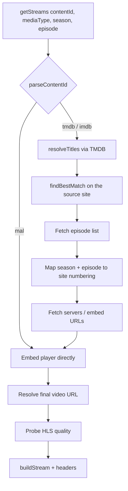

# Nuvio Anime Providers

[](manifest.json)
[](#-providers)
[](#-how-it-works)
[](package.json)

A collection of **anime streaming providers for Nuvio**, written as plain JavaScript modules and bundled with esbuild into a single file per provider.

Each provider receives a content ID from Nuvio (TMDB, IMDb, or MAL), looks the title up on its source site, and returns a list of playable streams — including the required `Referer`/`Origin` headers and subtitles when available.

> **Sub Indo & English** · **7 sources** · **no hardcoded API keys** · **sandbox-ready**

---

## ✨ Features

- **7 providers** in one package: HiAnime, OtakuDesu, Oploverz, Anoboy, Anichin, Gomunime, and GogoAnimes.
- **TMDB title resolution** — uses the `TMDB_API_KEY` injected by Nuvio, with no AniList/Kitsu/Jikan calls.
- **Smart title matching** — title normalization, season variants, and best-candidate selection from site search results.
- **Multi-season episode mapping** — computes absolute episode numbers for entries that merge several seasons (e.g. One Piece).
- **Layered player resolution** — from the episode page to server/embed endpoints, then to the final video URL.
- **HLS quality probing** — reads `RESOLUTION` values from `.m3u8` master playlists.
- **Per-request time budget** — hanging requests are cut off so they don't exhaust the runtime allowance.
- **IIFE bundles** — no Node APIs at runtime; only `fetch` and `cheerio` from the sandbox.

---

## 📺 Providers

| ID | Provider | Source | Language | Format | Notes |
| --- | --- | --- | --- | --- | --- |
| `hianime` | HiAnime | [hianime.at](https://hianime.at) | JA / EN | HLS | Sub & dub, direct MAL ID support |
| `otakudesu` | OtakuDesu | [otakudesu.blog](https://otakudesu.blog) | ID | HLS / MP4 | Indonesian subtitles |
| `oploverz` | Oploverz | [oploverz.ch](https://oploverz.ch) | ID | MP4 | Indonesian subtitles |
| `anoboy` | Anoboy | [anoboy.quest](https://anoboy.quest) | ID | MP4 | Indonesian subtitles |
| `anichin` | Anichin | [anichin.moe](https://anichin.moe) | ID / ZH | HLS / MP4 | Donghua with Indonesian subtitles |
| `gomunime` | Gomunime | [gomunime.top](https://gomunime.top) | ID | MP4 / HLS | Indonesian subtitles |
| `gogoanimes` | GogoAnimes | [gogoanimes.cv](https://gogoanimes.cv) | EN | HLS | English subtitles |

All providers support both `movie` and `tv`.

---

## 🚀 Quick Start

**Requirements:** Node.js 18+ and npm.

```bash
npm install
npm run build
```

Try a provider straight from the terminal:

```bash
npm run preview -- hianime 95479 tv 1 1
npm run preview -- otakudesu 95479 tv 1 1 --json
```

```text
hianime: 2 stream(s) in 1840ms
- 1080p | hls | Episode 1 • HD-1 (SUB)
  https://.../master.m3u8
```

> `preview` runs the built bundle inside a `node:vm` sandbox that mirrors the Nuvio runtime. Set `TMDB_API_KEY` in your environment for TMDB/IMDb IDs; `mal:` IDs work without it.

---

## 📦 Installing in Nuvio

1. Run `npm run build` so `providers/` contains the latest bundles.
2. Copy the project folder (or the contents of `providers/`) into your Nuvio provider directory.
3. Nuvio reads `manifest.json` to locate each scraper through its `filename` field, e.g. `providers/hianime.js`.
4. Enable the providers you want in the Nuvio settings.

---

## 🧩 Project Structure

```text
Anime/
├── build.mjs            # esbuild bundler (IIFE, one output per provider)
├── manifest.json        # Provider metadata read by Nuvio
├── package.json
├── providers/           # Build output — do not edit by hand
├── src/
│   ├── shared/          # http, tmdb, media, selection, log, text, etc.
│   ├── hianime/
│   │   ├── config.js    # Base URL, label, user agent, time budget
│   │   ├── client.js    # Site page scraper
│   │   ├── embed.js     # Embed/player resolution
│   │   ├── provider.js  # getStreams orchestration
│   │   └── index.js     # Entry point (exports getStreams)
│   └── ...              # Other providers follow the same pattern
└── tools/
    └── preview.mjs      # CLI to test a provider in a Nuvio-like sandbox
```

Files in `providers/` are **generated** by `build.mjs` and start with a warning banner. Change code in `src/`, not there.

---

## ⚙️ How It Works



1. **Nuvio calls** `getStreams(contentId, mediaType, season, episode)`.
2. **The ID is parsed** into `tmdb`, `imdb`, `mal`, or `unknown` (`shared/tmdb.js`).
3. **Titles are resolved** from TMDB — primary title, original title, alternative titles, and season variants.
4. **Site search runs** with several title variants; the best result is chosen based on similarity and season.
5. **The episode is mapped** — including conversion to absolute numbering for multi-season collection entries.
6. **Servers/embeds are opened** and the final video URL is extracted from iframes, players, or the site's internal API.
7. **HLS quality is probed** (for `.m3u8`), then the stream object is built with the required headers.

---

## 📄 Provider Contract

Every bundle exposes a single function:

```js
export async function getStreams(contentId, mediaType, season, episode) { ... }
```

| Parameter | Type | Description |
| --- | --- | --- |
| `contentId` | `string` | `tmdb:123`, `imdb:tt123`, `mal:456`, or a bare number |
| `mediaType` | `string` | `movie` or `tv` |
| `season` | `number \| null` | Season number |
| `episode` | `number \| null` | Episode number |

Returns `Promise<Stream[]>`; an empty array means no playable stream was found.

```ts
type Stream = {
  name: string;        // Provider name shown in Nuvio
  title: string;       // Stream label, e.g. "Episode 1 • HD-1 (SUB)"
  url: string;         // Final video URL (HLS/MP4)
  quality: string;     // "1080p", "720p", "HD", ...
  type: 'hls' | 'mp4';
  language: string;    // "id", "en", "ja", ...
  provider: string;    // Provider ID
  headers: Record<string, string>; // User-Agent, Referer, Origin
  subtitles?: Array<{ url: string; language: string; name?: string }>;
};
```

The `build.mjs` footer makes `getStreams` available through both `module.exports` and `globalThis`.

---

## ➕ Adding a Provider

1. Create `src/<name>/` with `config.js`, `client.js`, `provider.js`, and `index.js` (`export { getStreams } from './provider.js';`).
2. Add an entry to the `providers` array in `build.mjs`, including a unique `globalName`.
3. Add the provider name to `PROVIDERS` in `tools/preview.mjs`.
4. Register the new scraper in `manifest.json` (`id`, `filename`, `formats`, `contentLanguage`, etc.).
5. Run `npm run build` and test with `npm run preview -- <name> <contentId> tv 1 1`.

---

## 🛠️ Commands

| Command | Description |
| --- | --- |
| `npm install` | Install dependencies (`esbuild`, `cheerio`) |
| `npm run build` | Bundle all providers into `providers/` |
| `npm run watch` | Rebuild automatically when `src/` changes |
| `npm run preview -- <provider> <contentId> [movie\|tv] [season] [episode] [--json]` | Run a provider in the local sandbox |

---

## ⚠️ Notes

- Code running inside Nuvio lives in a lightweight sandbox: **do not rely on Node APIs** in `src/` providers — only `fetch`, `cheerio`, and the helpers already in `src/shared/`.
- Source sites may change their structure, block requests, or move domains at any time. If one provider breaks, fix its `config.js` and scraper without touching the others.
- This project ships no API keys. `TMDB_API_KEY` is injected by Nuvio at runtime.
- For personal use. Respect copyright and the terms of service of each source site.

---

## 🙏 Credits

Made by **Kurumi**. Built with [esbuild](https://esbuild.github.io/) and [cheerio](https://cheerio.js.org/).
